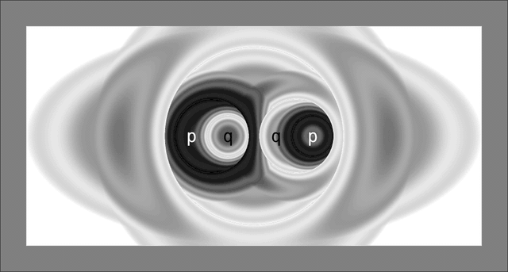
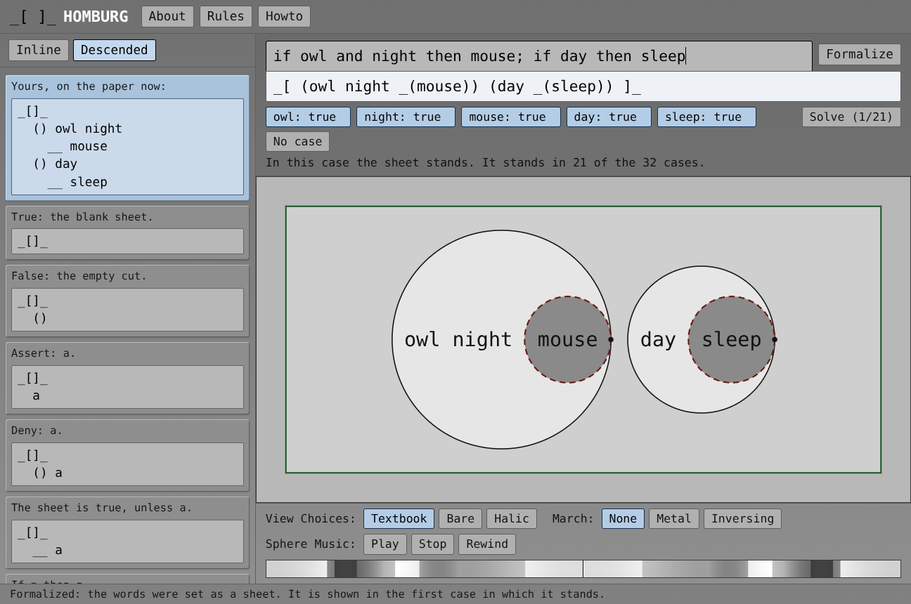
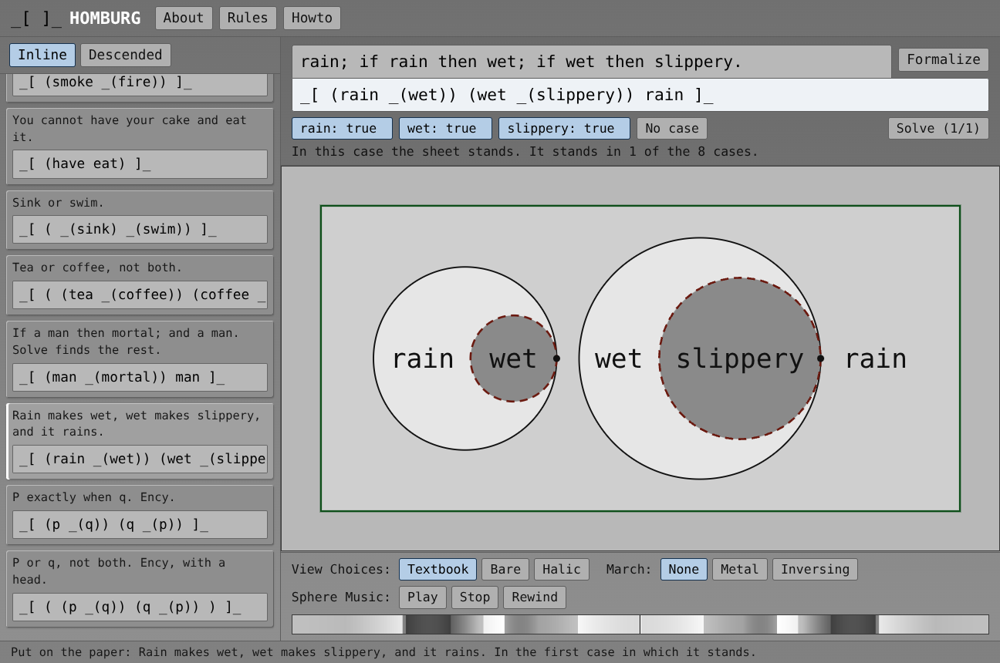
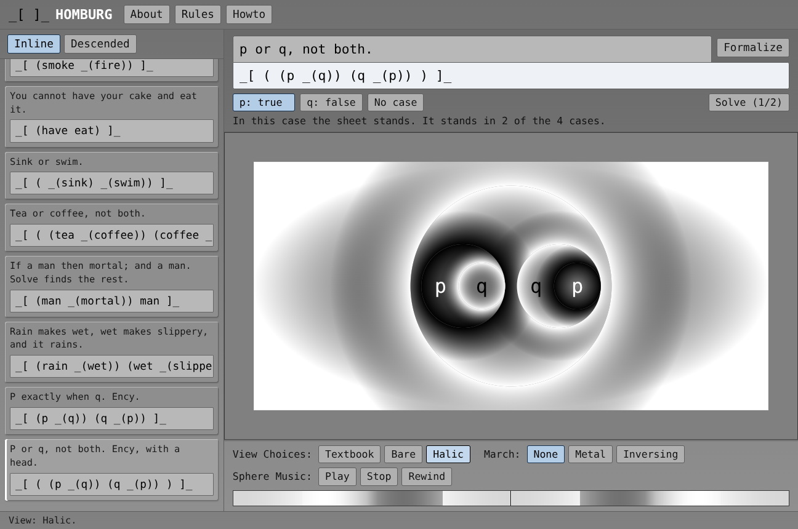
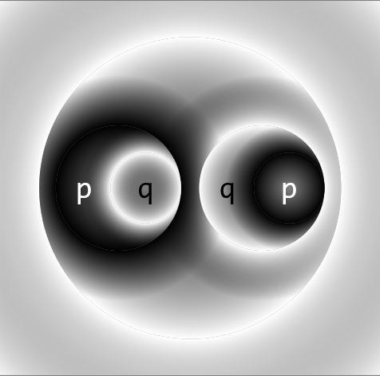

<p align="center"><a href="https://silberpunkt.github.io/homburg/"></a></p>

# Homburg

**A Peirce sheet in one file.** Type a logical statement in a line, or in plain words, and it is drawn as circles on a sheet of paper, tried in every case, said back in words, and sung.

## **[Open Homburg](https://silberpunkt.github.io/homburg/)**

*One file, nothing to install, nothing fetched, nothing sent anywhere. Save the page and it works from your disk.*

[](https://silberpunkt.github.io/homburg/)

*`_[ ( (p _(q)) (q _(p)) ) ]_` : p or q, not both. Halic view, with the march set to Metal. The ripples run toward the rim of whatever is true and away from the rim of whatever is false.*

---

## What it does

- **The sheet.** The logic is that of Charles Sanders Peirce's existential graphs. Whatever is written on the sheet is asserted. Things side by side are asserted together. A closed line drawn round something, a cut, denies what it holds. Everything else follows from those three.
- **The line.** A sheet is typed in a line. `_[ ]_` is the sheet, `( )` is a cut, and `_( )` is a scroll: a cut drawn in one stroke with what holds it, read "unless". So `_[ (rain _(wet)) ]_` says: if rain then wet.
- **In words.** The sheet is said back in plain words, worked out by rule. The words can be written in, too: type `if rain then wet; not dry`, press **Formalize**, and they become a sheet.
- **The picture.** The whole pane is the paper, with a margin. Each cut is a circle, and a scroll touches the wall of what holds it. Nothing touches the paper's edge.
- **Trying a case.** Press a name, on the paper or under the line, to set it true or false. The page shows whether the sheet stands. **Solve** steps through every case in which it does, and is absent when there is none.
- **Three views.** Textbook, with outlines. Bare, with tones only. And Halic, in which each form is lit at its rim, white if it comes out true and black if false.
- **The march.** In Halic the light can be set moving. **Metal** sends ripples through it. **Inversing** turns it slowly over to its negative and back; half way round is the same sheet read as Peirce's earlier entitative graphs read it.
- **Sphere Music.** A pickup is carried round the forms, and the light under it is sounded: white high, black low, grey silent. The strip beneath the paper is the score.
- **Descended.** The column shows each sheet in a line or descended, one thing per line, as indented text. `()` leads a line as "not" and `__` as "unless".

## Three pictures of the page



*Written in words and formalized. The blue card at the head of the column is the same sheet descended.*



*Rain makes wet, wet makes slippery, and it rains. Solve finds the one case in which the sheet stands, and so does the reasoning.*



*Halic, standing still.*

## From the workbench

Six pictures taken by User1 while it was being made, in the order they happened.


*Before there was a page. The notes on the descended form, zoomed out until only the shapes are left. They already show which thing hangs on which.*


*The first picture. The sheet `_[ (p _(q)) (q _(p)) ]_` typed under Sandeko, in Nuage, which draws a ring round every bracket it finds. Two eyes in a square head: the owl, Ency.*


*An early Homburg, with Solve stepping through the five cases in which a sheet stands.*


*Halic, the first time it was seen. A sheet that falls, with one promise in it that holds.*



*Halic again. One or the other, not both.*


*Sphere Music, recorded and drawn as a spectrogram, with the pickup going round the owl's eyes. Each arc is a rim and each step is a wall.*

## The notation

The way of typing a sheet was settled first, in one day, as a note. It is in [notes](notes), with a small program that reads every example in it and checks what each one says. The note stops where the page begins.

## The name

`_[ ]_` is the blank sheet, and the hat that heads every sheet. A Homburg is known for the crease along the middle of its crown, which the form has in its single space. It is not known whether Peirce wore one. The page's own About says more, and says what was checked.

## For whoever opens the file

The page has a **Howto** panel: the parts, where each begins in the file, and the tricks. The first half of the program needs no page and is tested without a browser:

```
node homburg.test.js homburg.html
```

It tries every case of each sheet for its truth, sends sheets through both typed forms and through words and back, tries the misspellings, measures the picture for touching and clearance, and checks the light and the score.

It was tested by eye and ear in LibreWolf, seen and heard in Chromium, and run in Firefox and WebKit.

## Credits

The notation, the rules of the picture, the margin, Halic, the march, Sphere Music and the owl are User1's. The program and the tests are eniamb's. The logic is Charles Sanders Peirce's (1839 to 1914). The idea of circles drawn round text came from Sandeko, in [Nuage](https://github.com/silberpunkt/nuage). The page uses no code or fonts from anyone else.

## Thanks

To Peirce, for the graphs. To those who keep his papers at Houghton Library and those who have catalogued and edited them. And to the radio and plasma wave group at the University of Iowa, who keep [space-audio.org](https://space-audio.org/), where what spacecraft have measured can be heard and seen. Homburg uses none of their recordings; it owes them the idea that a measurement may be listened to. The notes are in [`__IOU`](__IOU).

## Licence

MIT. See [LICENSE](LICENSE).
